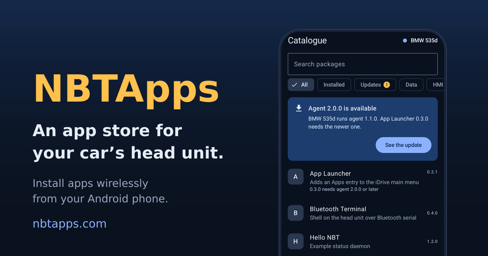

# NBTApps

An app store for your car’s head unit. Browse a catalogue of apps for your BMW’s NBT Evo head unit (iDrive 6)
and install them wirelessly from your Android phone.

> **Beta.** NBTApps is in beta. Things may change or break.

## How it works

1. **Pair with your car.** Connect your phone to the car and enter the code shown on the head unit’s screen. After
   that, your phone proves who it is every time it connects.
2. **Browse the catalogue.** Look through the apps for your head unit, with versions and details for each one.
3. **Install wirelessly.** Your phone downloads the package and sends it to the car. The transfer keeps going with
   the phone’s screen off, and a notification shows its progress.
4. **Update Seamlessly.** Use your phone to wirelessly update the apps on your car, no cables required.

## Built for the car

- **Signed and verified.** The catalogue and every package are signed. Your phone checks the signatures before it
  sends anything to your car.
- **No account needed.** No sign-up and no login. Your paired head units and keys stay on your phone.
- **No cables or adapters.** Once the Agent is set up, you don’t need an ENET cable or OBD adapter to install apps.
- **Copes with lost connections.** If the link drops or the car restarts, the app reconnects and picks up where it
  left off.

## Get started

NBTApps has two parts, and you need both: **NBTApps for Android** on your phone (Android 13 or later), and the
**NBTApps Agent** on your car’s head unit. You install the Agent once, before you pair your phone.

- **Download and help:** [nbtapps.com](https://nbtapps.com) ([Download](https://nbtapps.com/download/),
  [Support](https://nbtapps.com/support/)).
- **Setting up the Agent:** [headunit/INSTALL.md](headunit/INSTALL.md) walks through it. It starts from a root
  shell on the head unit, which it doesn’t cover how to get.

## Community packages

Besides the project’s own packages, the catalogue lists **community** packages: apps that other developers build,
sign and submit.

**Submit your own app** to [tom-pryor/nbtapps-packages](https://github.com/tom-pryor/nbtapps-packages) by pull
request:

1. Build your package with [`headunit/tools/nbtpkg.py`](headunit/tools/nbtpkg.py), following
   [`headunit/spec/manifest.schema.json`](headunit/spec/manifest.schema.json), and sign it with a key of your own.
2. Publish the `.nbtpkg` archive at an https address of your own, such as a release of your app’s repo.
3. Open a pull request that adds your package’s listing, your public key and a record of the version, which pins
   the archive’s SHA-256 and names the source commit it was built from.

Each pull request gets an automatic check, and then a review of the source and of the archive. Once accepted, the
version is listed in the next publish of the catalogue. Your archive stays at your address, as you signed it. The
[repo’s README](https://github.com/tom-pryor/nbtapps-packages#readme) has the layout, the rules (ids, iDrive
plugins, logs) and how to run the check before opening a pull request.

## What’s in this repo

| Folder | What it is |
|---|---|
| [`headunit/`](headunit/) | The car’s side: the **NBTApps Agent** (`nbtagent`, `nbtctl`), which installs packages on the head unit; **NBTApp**, an iDrive plugin whose menu starts the Agent and pairs phones; the package tools; and the protocol and package definitions both sides share (`headunit/spec/`). C++ for QNX 6.5.0 plus Python tools. See [headunit/README.md](headunit/README.md). |
| [`android/`](android/) | **NBTApps for Android** (`com.nbtapps.store`): browses the catalogue, pairs with a head unit and installs packages through the Agent. A Gradle project of its own: open `android/` in Android Studio. |

The two are built separately. Some Android tests run against the agent in `headunit/`, which they find next to
`android/` (`NBT_AGENT_REPO` names another checkout), and `android/tools/sync_agent_vectors.sh` copies the
agent's test vectors and packages into the app's test resources.

The official catalogue is a separate repo.

## Contributing

Pull requests are welcome. Opening one means you agree to the contributor agreement in
[CONTRIBUTING.md](CONTRIBUTING.md), which also says what to check first.

## Disclaimer

NBTApps is an independent project. It is not affiliated with, endorsed by or supported by BMW AG or Google.
BMW and iDrive are trademarks of BMW AG; Android and Android Auto are trademarks of Google LLC. They are named here
only to say what the software works with.

NBTApps changes the software of your car’s head unit: it installs programs onto it, and its plugin runs inside
the process that draws iDrive. A fault there can stop iDrive from starting. The software comes as is, without any
warranty (see the [license](LICENSE.md)); you use it at your own risk and are responsible for what you do to your
own car.

Security problems: see [SECURITY.md](SECURITY.md).

## License

[PolyForm Strict License 1.0.0](LICENSE.md): you may use the software for any noncommercial purpose; you may not
distribute it or make changes or new works based on it. Every source file says so in its first lines, with the
SPDX identifier `LicenseRef-PolyForm-Strict-1.0.0` (PolyForm Strict is not on the SPDX list, hence the
`LicenseRef-`), and [REUSE.toml](REUSE.toml) covers the files that cannot carry a header. `reuse lint` checks
both. The license texts are in [LICENSES/](LICENSES/).

Third-party code keeps its own terms: TweetNaCl in `headunit/agent/vendor/tweetnacl/` (public domain) and the
Gradle wrapper in `android/` (Apache-2.0).

Copyright (c) 2026 Tom Pryor - NBTApps (https://github.com/tom-pryor/nbtapps)
